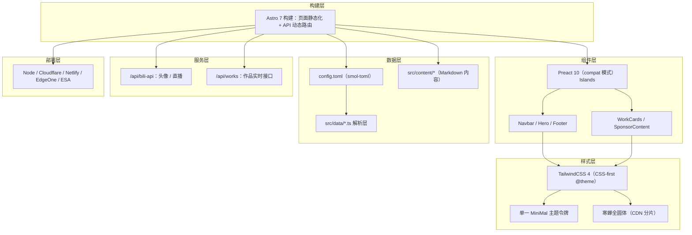

# 技术架构

> 产品需求见 [产品需求文档](prd.md)，构建部署细节见 [部署指南](deploy.md)。

## 1. 架构设计



## 2. 技术选型

| 类别 | 选型 | 说明 |
| --- | --- | --- |
| 框架 | Astro 7 | 页面 `prerender = true` 静态化，API 路由保持动态 |
| UI 运行时 | Preact 10（`@astrojs/preact` compat） | 沿用 React 写法（hooks / `forwardRef` 仍从 `react` 导入），运行时由 `preact/compat` 提供，首屏 JS 比 react-dom 少约 165KB |
| 样式 | TailwindCSS 4（`@tailwindcss/vite`） | CSS-first，零配置文件，设计令牌写在 `@theme` |
| 组件 | shadcn/ui（自生成） | `Button`、`Card`、`Badge`、`Input`、`Textarea`、`Icon` 等 |
| 图标 | Font Awesome 7 图标数据 | `Icon` 组件把图标数据渲染为内联 SVG，不引入 `react-fontawesome` / `fontawesome-svg-core`（省约 91KB 首屏 JS） |
| 字体 | 寒蝉全圆体（ChillRoundF） | CDN `fontsapi.zeoseven.com` 分片按需加载，`main`(400) + `bold`(700) |
| 配置 | TOML（`smol-toml`） | `config.toml` 驱动全部站点内容，构建环境变量可覆盖 |
| 内容源 | `markdown` / `strapi` | `content_source` 切换，Strapi 在构建时拉取 |
| 包管理 | pnpm | Node ≥ 22.12 |
| 部署 | 多适配器 | 由 `DEPLOY_TARGET` 在构建时选择，详见部署指南 |

## 3. 主题与设计令牌

单一主题，无切换。令牌定义在 `src/styles/global.css` 的 `@theme` 块，Tailwind 自动输出为 `:root` 上的 CSS 变量：

| 令牌 | 值 | 用途 |
| --- | --- | --- |
| `--color-bg-primary` | `#000000` | 页面背景 |
| `--color-bg-card` / `-hover` | `#111111` / `#1a1a1a` | 卡片背景与悬停 |
| `--color-border-default` / `-hover` | `#1f1f1f` / `#333333` | 边框 |
| `--color-text-primary` / `-secondary` / `-muted` | `#f5f5f5` / `#a0a0a0` / `#666666` | 文字层次 |
| `--color-accent` / `-hover` | `#34d399` / `#6ee7b7` | 翡翠绿强调色 |
| `--font-sans` / `--font-display` | 寒蝉全圆体 | 正文与标题 |

## 4. 路由与页面

| 路由 | 文件 | 渲染方式 | 说明 |
| --- | --- | --- | --- |
| `/` | `src/pages/index.astro` | `prerender = true` | 单页：Hero + 可选模块 |
| `/sponsor` | `src/pages/sponsor.astro` | `prerender = true` | 赞助页，受总开关控制 |
| `/api/bili-api` | `src/pages/api/bili-api.ts` | 动态 | B站头像 / 直播状态代理 |
| `/api/works` | `src/pages/api/works.ts` | 动态 | 作品列表实时接口 |

- Astro 中**一个路由 = `src/pages/` 下一个文件**；非独立页面的内容作为主页模块渲染，无需单独文件。
- 水合策略：首屏必需的 island 用 `client:load`（Hero），导航等非首屏交互用 `client:idle`，页面下方模块用 `client:visible`（WorkCards、Footer）。

## 5. API 服务

### 5.1 `/api/bili-api`

| 参数 | 功能 | 上游接口 |
| --- | --- | --- |
| `?action=avatar&uid=...` | 头像图片代理，规避浏览器 CORS / ORB 拦截 | `api.bilibili.com/x/web-interface/card` |
| `?uid=...` | 直播状态检测 | 直播间信息接口 |

- 服务端先向 B站首页握手获取匿名 `buvid3` cookie，再携带该 cookie + 浏览器 UA + 匹配 Referer 请求上游，规避数据中心 IP 风控（-352 / -412）。
- 缓存：头像 `Cache-Control: max-age=3600`（1 小时），直播检测 5 分钟限频。
- 头像获取失败时前端 `onError` 回退到 `public/avatars/avatar.webp`，不裂图。

### 5.2 `/api/works`

- 运行时优先用 `node:fs` 读取 `src/content/works/work.md`（捕获最新变更），读取失败自动回退到构建时快照。
- 纯静态部署（ESA）由边缘函数 `esa/functions/bili-api.ts` 提供 B站代理，`/api/works` 不参与静态构建。

## 6. 字体系统

| 字体 | 用途 | 加载方式 | 字重 |
| --- | --- | --- | --- |
| 寒蝉全圆体 | 显示 / 正文 | CDN `fontsapi.zeoseven.com`（`3/main` + `3/bold`） | 400 / 700 |

- 在 `Layout.astro` 的 `<head>` 中直接引入，与主样式表并行请求；不写进 `global.css`，避免 HTML → CSS → 字体 CSS → 分片的串行链路。
- 不使用 Google Fonts CDN，也不自托管字体文件。
- 组件通过 `font-sans` / `font-display` 工具类或 `var(--font-*)` 引用。

## 7. 目录结构与布局

```text
src/
├── components/
│   ├── react/      # 交互组件（Preact compat）：Navbar、Hero、Footer、WorkCards、SponsorContent
│   └── ui/         # shadcn/ui 基础组件 + Icon
├── content/        # Markdown 内容（posts / works）
├── data/           # config.toml 解析 + 数据文件（profile、sponsor、posts 等）
├── hooks/          # useLivePulse（直播脉冲动画）
├── interfaces/     # 类型定义（Work）
├── layouts/        # Layout.astro（全局布局、字体、lang 自适应）
├── lib/            # strapi 客户端、work 解析、utils
├── pages/          # 路由 + API
├── styles/         # global.css（@theme 令牌）
└── utils/          # live-ring 等动画工具
esa/functions/      # ESA 边缘函数（静态部署时的 B站代理）
scripts/            # esa-build.mjs 等构建脚本
```

```text
Layout.astro
  ├── Navbar        client:idle
  ├── Hero          client:load（首屏）
  ├── #profile      [modules].profile
  ├── #works        [modules].works   → WorkCards client:visible
  ├── #posts        [modules].posts
  ├── #repository   [modules].repository
  ├── #contact      [modules].contact
  └── Footer        client:visible
```

> `src/components/react/` 下另有 `About`、`Skills`、`Projects`、`Timeline`、`Posts`、`Contact` 等模板遗留组件，当前未被页面引用，可按需启用或删除。

## 8. 数据模型

站点内容全部来自 `config.toml`，由 `src/data/*.ts` 解析为组件 props；内容型数据（作品 / 文章）来自 Markdown 或 Strapi。

```typescript
// config.toml → Profile（src/data/profile.ts）
interface Profile {
  name: string;
  site_title?: string;
  site_description?: string;
  logo?: string;
  avatar: string;
  bilibili_uid?: number;
  titles?: string[];            // Hero 打字机轮播标题
  typewriter_speed?: number;
  mode?: "single" | "scroll";
  content_source?: "markdown" | "strapi";
  bio?: string;
  stats?: Stat[];              // 关键数据统计
  show_social_icons?: boolean; // false 时社交链接只显示文字
  modules?: Modules;
  socials: SocialLink[];
  footer?: Footer;
}

interface Modules {
  profile?: boolean;
  works?: boolean;
  posts?: boolean;
  repository?: boolean;
  contact?: boolean;
}

interface SocialLink {
  name: string;
  url: string;
  icon?: string;   // Font Awesome 图标名
  logo?: string;   // 自定义图标图片，优先于 icon
  show?: boolean;  // false 时单独隐藏
}

interface Footer {
  show?: boolean;
  items?: FooterItem[];   // CDN / Host 等
  icp?: FooterIcp;        // 备案号，独立开关
}

interface FooterItem {
  label?: string;         // 前缀文字，如 "CDN - "
  text: string;
  url: string;
  show?: boolean;
}

interface FooterIcp {
  show?: boolean;
  label?: string;
  text?: string;
  url?: string;
}

// 内容数据
interface Work {          // src/interfaces/work.ts
  id: number;
  documentId: string;
  title: string;
  description: string;
  url?: string;
  tags: string[];
  body?: string;          // markdown 模式下的正文
  createdAt: string;
  updatedAt: string;
  publishedAt?: string;
}

interface Post {          // src/data/posts.ts
  date: string;
  title: string;
  summary: string;
  url?: string;
}
```

## 9. 约束与约定

- **技术栈**：Astro 7 + Preact 10（compat）+ TailwindCSS 4 + Font Awesome 7 图标数据 + TypeScript；不新增 `react` / `react-dom` 依赖。
- **样式**：Tailwind 工具类优先，仅在动态计算值、三元表达式、CSS 变量引用时用内联 `style`；避免 `@apply` 与手写 CSS。
- **组件**：优先复用 `src/components/ui/` 下的 shadcn/ui 组件；图标统一用 `Icon` 组件 + Font Awesome 图标数据。
- **API 集成**：B站相关请求统一走 `/api/bili-api`；服务端直连 B站易触发反爬（-352 / -401），头像推荐手动下载到 `public/avatars/` 或走带缓存的代理；**不要改回浏览器 JSONP 直连**（跨域 Referer 会直接 403）。
- **动画**：Hero 直播脉冲圆环由自定义 Hook `useLivePulse` + `requestAnimationFrame` 驱动，绘制逻辑解耦在 `src/utils/live-ring.ts`。
- **配置**：站点内容只改 `config.toml`，环境变量优先级更高（构建时读取，改后需重新构建）。
- **验证后清理**：功能验证结束需清理一次性脚本、缓存与调试文件，保持工作区干净。
