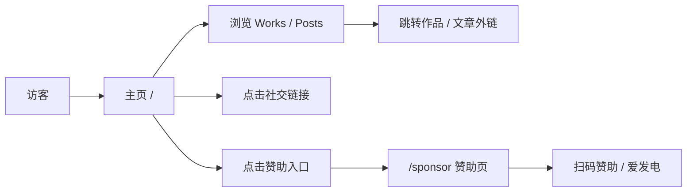

# 产品需求文档（PRD）

> 产品视角的功能与界面需求。技术实现见 [技术架构](architecture.md)，构建部署见 [部署指南](deploy.md)。

## 1. 产品概述

YLOVEXLN 个人主页：以单页为主的个人品牌站点，**纯黑极简 + 翡翠绿强调的单一主题**，展示个人形象、作品、文章、赞助入口与联系方式，并深度集成 B站头像与直播状态。

| 项目 | 说明 |
| --- | --- |
| 目标用户 | 希望拥有个人品牌展示页面的开发者 / 设计师 |
| 核心价值 | 极简视觉、模块化可配置（`config.toml`）、构建期静态化的高性能、B站深度集成 |
| 形态 | 静态页 + SSR API，多目标部署（Node / Cloudflare / Netlify / EdgeOne / ESA） |
| 技术栈 | Astro 7 + Preact 10（React compat 写法）+ TailwindCSS 4 + Font Awesome 7 图标数据 + TypeScript |

## 2. 核心功能

### 2.1 功能模块

1. **主题** — 纯黑极简 + 翡翠绿强调（MiniMal 风格），**无主题切换**
2. **英雄区（Hero）** — B站头像（服务端代理）、直播脉冲圆环、打字机标题轮播、社交链接
3. **导航系统** — 顶部固定导航栏，滚动时毛玻璃效果
4. **页面模式** — `single`（仅 Hero + 导航 + 页脚）/ `scroll`（向下滚动展示各模块）
5. **作品（Works）** — 卡片网格，含标签与外链，支持实时刷新（`/api/works`）
6. **文章（Posts）** — 列表展示日期 / 标题 / 摘要，点击跳转外链
7. **占位模块** — Profile / Repository / Contact，开关已预留，当前渲染「内容待配置」
8. **赞助页（`/sponsor`）** — 微信 / 支付宝收款二维码、爱发电入口，受总开关控制
9. **页脚** — CDN / Host / 备案信息，支持整行与单项开关
10. **B站集成** — 头像自动获取 + 直播状态检测（统一经本站服务端代理）

### 2.2 页面与模块

| 路由 | 模块 | 功能描述 | 开关 |
| --- | --- | --- | --- |
| `/` | Navbar | 顶部固定导航 | 常驻 |
| `/` | Hero | 头像 + 直播脉冲 + 打字机标题 + 社交链接 | 常驻 |
| `/` | Profile | 个人介绍（占位） | `[modules].profile` |
| `/` | Works | 作品卡片网格，含标签与外链 | `[modules].works` |
| `/` | Posts | 文章列表（日期 / 标题 / 摘要 / 链接） | `[modules].posts` |
| `/` | Repository | 代码仓库展示（占位） | `[modules].repository` |
| `/` | Contact | 联系方式（占位） | `[modules].contact` |
| `/` | Footer | CDN / Host / 备案信息 | `[footer].show`、`[footer.icp].show` |
| `/sponsor` | SponsorContent | 赞助方式与二维码 | `[[socials]]` 入口 + `SPONSOR_SHOW` |

> 页面模块仅在 `mode = "scroll"` 时渲染；`single` 模式只保留 Hero + 导航 + 页脚。

## 3. 核心流程

- 赞助入口关闭时（`show = false` 或环境变量 `SPONSOR_SHOW=false`），首页不显示该入口，直接访问 `/sponsor` 会跳回首页。

## 4. 用户界面设计

### 4.1 MiniMal 主题

- **背景**：纯黑 `#000000`；卡片 `#111111`；边框 `#1f1f1f`
- **文字层次**：主 `#f5f5f5` / 次 `#a0a0a0` / 弱 `#666666`
- **强调色**：翡翠绿 `#34d399`（悬停 `#6ee7b7`），用于关键高亮与交互态
- **字体**：寒蝉全圆体，经 CDN 分片按需加载（400 / 700 双字重）
- **导航**：顶部固定，滚动时毛玻璃
- **按钮**：简洁无边框风格，悬停有微光效果
- **设计令牌**：统一在 `src/styles/global.css` 的 `@theme` 中定义，组件只用 Tailwind 工具类

### 4.2 响应式设计

- 桌面优先，完美适配 1080p
- 平板：多列布局降为单列，调整间距
- 手机：全宽布局，堆叠排列，缩小字号与间距

## 5. 关键约束（产品侧）

- 字体全部走 CDN，**不使用 Google Fonts**
- B站接口只经本站 `/api/bili-api` 代理（头像缓存 1 小时、直播检测限频 5 分钟/次），浏览器不直连 B站 CDN
- 页面内容构建期静态化、交互组件按需水合，保证首屏性能
- 站点内容全部由 `config.toml` 驱动，改内容不改代码
- 单一主题，不做主题切换
